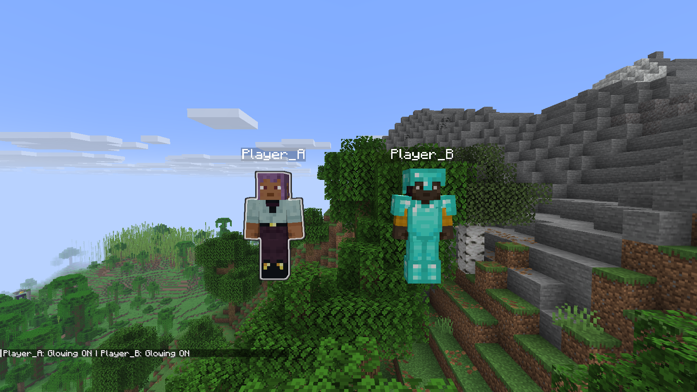
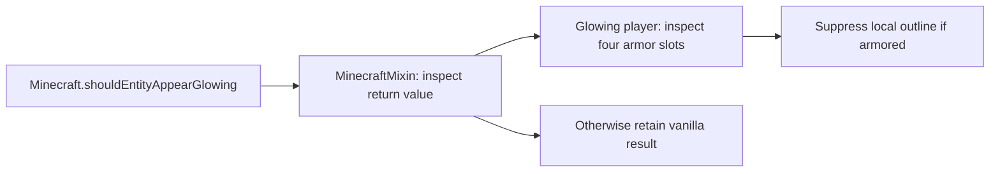

<div align="center">
<h1>ArmorGlow Filter</h1>
<hr>
<p><strong>3 rendering rules in one place: player outlines, armor slots, unchanged Glowing.</strong></p>
<p>


</p>
<p>
<a href="https://github.com/hhhhhffd/ArmorGlowFilter/releases/latest"></a>
<a href="https://github.com/hhhhhffd/ArmorGlowFilter/releases"></a>
</p>
<p><a href="https://github.com/hhhhhffd/ArmorGlowFilter/releases">Download</a> · <a href="#architecture">Architecture</a> · <a href="#build">Build</a></p>

</div>

## Executive Summary

ArmorGlow Filter is a client-side Fabric mod for Minecraft Java 1.21.11. It hides an existing vanilla Glowing outline on a player while any of the four armor slots is occupied; held items do not count. Removing the armor makes the outline visible again if Glowing still applies.

Only local rendering is affected: the effect, network data, server mods, and other players' views are unchanged. The mod neither adds Glowing nor changes mob outlines.

## Technical Stack

| Layer | Technology | Version / role |
| --- | --- | --- |
| Core | Minecraft Java | 1.21.11 |
| Core | Fabric Loader | 0.20.1 in build; 0.18.4 or newer required |
| Core | Java | 21 or newer |
| Build | Fabric Loom / Gradle Wrapper | 1.13.6 / 9.2.1 |

## Architecture



- The return-value mixin only suppresses an existing result for a currently glowing player; it does not create outlines or modify the effect.
- Checking armor equipment slots instead of held items keeps the filter tied to worn armor. The mod has no settings or controls.

## Project Structure

```text
.
├── src/client/        # Client-only mixin
├── src/main/          # Fabric metadata and mixin declaration
├── gradle/wrapper/    # Gradle wrapper configuration
├── docs/media/        # Preview image
├── build.gradle       # Loom build
└── gradle.properties  # Versions and build settings
```

## Installation

1. Install [Fabric Loader](https://fabricmc.net/use/installer/) 0.18.4 or newer for Minecraft Java 1.21.11 and use Java 21 or newer.
2. Download `armorglow-1.0.0.jar` from [Releases](https://github.com/hhhhhffd/ArmorGlowFilter/releases) and place it in the `mods` folder.
3. Launch the Fabric profile. Fabric API is a build dependency but is not required to run this mod.

## Build

Use JDK 21 and the included Gradle 9.2.1 wrapper.

```sh
./gradlew build
```

On Windows, run `gradlew.bat build`. The resulting JAR is in `build/libs/`.

## Deliverables & Links

[Releases](https://github.com/hhhhhffd/ArmorGlowFilter/releases) · [Source](https://github.com/hhhhhffd/ArmorGlowFilter) · [Preview](docs/media/preview.png)

## License

Not specified; license terms are TBD.
